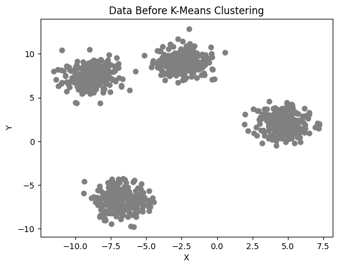
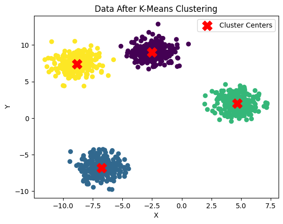
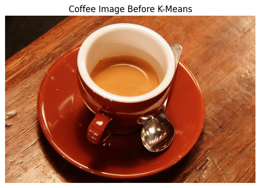
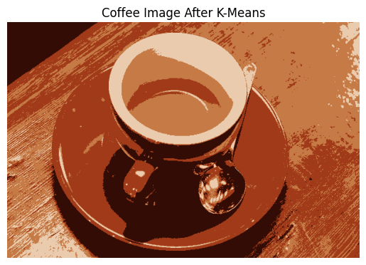
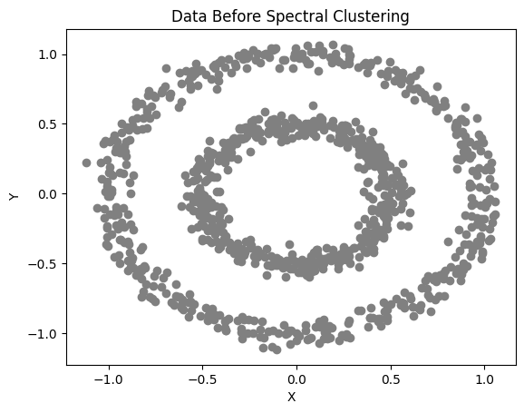
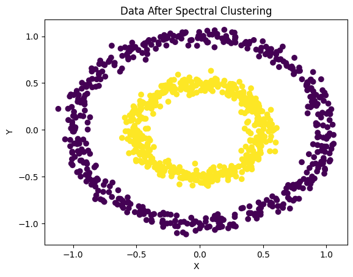
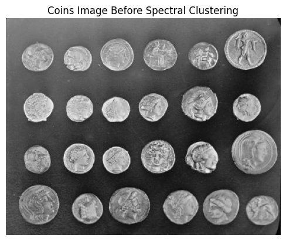
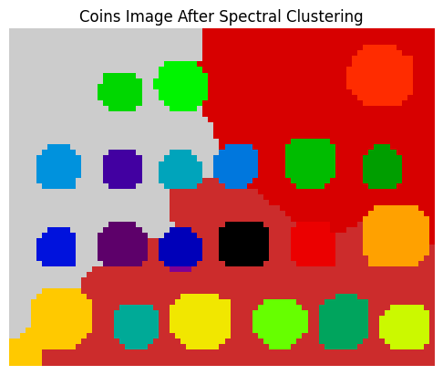

# BSCS 4388 – Computer Vision Labs 1 & 2

This repository contains the implementation of **K-Means Clustering** and **Spectral Clustering** using Python. Both algorithms are applied to generated datasets and real images to demonstrate clustering and image segmentation techniques.

## Lab 1: K-Means Clustering

**Dataset 1: Generated Data**

K-Means is applied to 1,000 generated data points with 4 clusters.

| Before Clustering | After Clustering |
|---|---|
|  |  |

**Dataset 2: Coffee Image**

K-Means is applied to the RGB pixel values of a coffee image to reduce its colors to 4 representative colors.

| Original Image | After K-Means |
|---|---|
|  |  |

## Lab 2: Spectral Clustering

**Dataset 1: Generated Data**

Spectral Clustering is applied to 1,000 generated points arranged in two concentric circles, using 2 clusters.

| Before Clustering | After Clustering |
|---|---|
|  |  |

**Dataset 2: Coins Image**

Spectral Clustering is applied to a grayscale coins image using Gaussian smoothing, image rescaling, graph-based pixel representation, and 25 clusters.

| Original Image | After Spectral Clustering |
|---|---|
|  |  |

## Tools and Libraries

- Python
- Google Colab
- NumPy
- Matplotlib
- Scikit-learn
- Scikit-image

## Project Files

- `BSCS4388_Lab1_2.ipynb` – Google Colab notebook
- `bscs4388_lab1_2.py` – Python source code
- `outputs/` – Eight images showing the results before and after clustering

## How to Run

Install the required libraries:

```bash
pip install numpy matplotlib scikit-learn scikit-image
```

Run the Python script:

```bash
python bscs4388_lab1_2.py
```

The script generates eight PNG images containing the clustering results.
